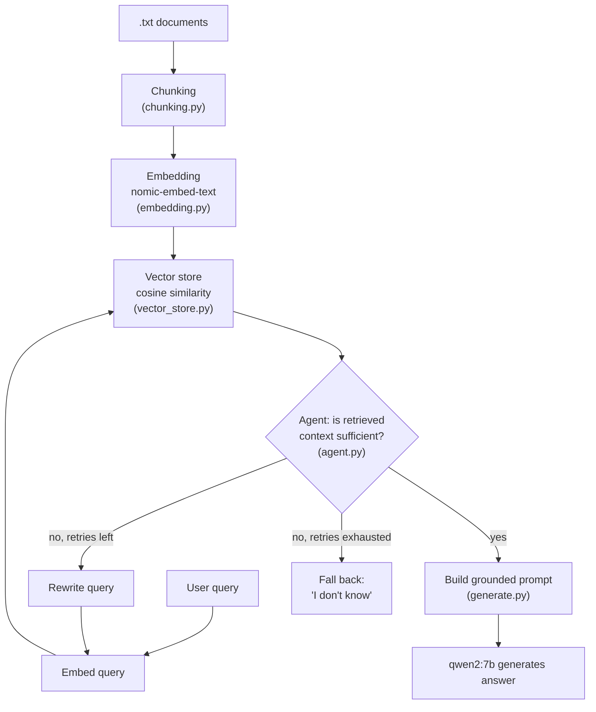

# RAG From Scratch

A retrieval-augmented generation (RAG) pipeline built entirely from first
principles in Python — no LangChain, no LlamaIndex, no managed vector database.
Every stage (chunking, embedding, similarity search, retrieval-quality
judgment, query rewriting) is implemented directly so the mechanics are fully
visible and debuggable, rather than hidden behind framework abstractions.

Runs fully locally via [Ollama](https://ollama.com) — no API keys, no cloud
calls, no per-token cost.

## Why build RAG from scratch

Frameworks like LangChain are convenient in production, but they make it easy
to wire together a RAG pipeline without understanding what each stage is
actually doing to your data — how chunk boundaries affect retrieval, why
cosine similarity is the right metric for normalized embeddings, or what a
"low-confidence retrieval" looks like in practice. This project exists to
make every one of those decisions explicit and inspectable, and to measure
their effect with real numbers rather than assuming a framework default is
good enough.

## Architecture



## How it works

1. **Chunking** (`chunking.py`) — splits `.txt` documents into sentence-level
   chunks using a regex that splits on periods followed by whitespace, so
   most abbreviation-period false splits are avoided.
2. **Embedding** (`embedding.py`) — converts each chunk into a 768-dimension
   vector via Ollama's `nomic-embed-text` model.
3. **Vector store** (`vector_store.py`) — cosine similarity search over
   chunks, implemented from scratch with NumPy (no FAISS, no managed DB).
4. **Generation** (`generate.py`) — builds a prompt that grounds the model's
   answer strictly in retrieved context, and calls `qwen2:7b`.
5. **Agent loop** (`agent.py`) — after retrieval, a second LLM call judges
   whether the retrieved context actually contains an answer to the question.
   If not, it rewrites the query and retries retrieval (up to a configurable
   limit) before falling back to an explicit "I don't know" rather than
   hallucinating from insufficient context.
6. **Entry point** (`main.py`) — wires the above into an interactive terminal
   chat loop with conversation memory.

## Knowledge base

Four public-domain U.S. government mining-safety publications (NIOSH / Bureau
of Mines), covering haulage, maintenance, blasting, and underground mobile
equipment:

- [Haulage Truck Dump Site Safety](https://www.cdc.gov/niosh/media/pdfs/2026/04/2001-124.pdf) (NIOSH 2001-124)
- [IC 9424: Mobile Mine Equipment Maintenance Safety](https://stacks.cdc.gov/view/cdc/206404/cdc_206404_DS1.pdf) (Bureau of Mines, 1995)
- [IC 8925: Explosives and Blasting Procedures Manual](https://stacks.cdc.gov/view/cdc/206002/cdc_206002_DS1.pdf) (Bureau of Mines, 1983)
- [Injuries associated with continuous miners, shuttle cars, and LHDs](https://stacks.cdc.gov/view/cdc/8904/cdc_8904_DS1.pdf) (NIOSH)

## Quickstart

```bash
# 1. Install Ollama: https://ollama.com/download

# 2. Pull the required models
ollama pull qwen2:7b
ollama pull nomic-embed-text

# 3. Set up the environment
python3 -m venv .venv
source .venv/bin/activate
pip install -r requirements.txt

# 4. (Optional) Verify Ollama is reachable
python3 scripts/check_ollama_connection.py

# 5. Run it
python3 main.py
```

## Example session

```
Loading knowledge base...
Ready — 13 chunks loaded.

Ask a question (or 'quit'): How often should I change the oil on a Caterpillar excavator?
  [attempt 1] query: 'How often should I change the oil on a Caterpillar excavator?' -> sufficient: True

Every 500 operating hours.

Ask a question (or 'quit'): What's the warranty period on an Atlas Copco drill rig?
  [attempt 1] query: 'What's the warranty period on an Atlas Copco drill rig?' -> sufficient: False
  [attempt 2] query: 'What is the warranty duration for an Atlas Copco drill rig?' -> sufficient: False

I don't know. The context provided doesn't include information about the warranty period on an Atlas Copco drill rig.
```

(Real transcript — not fabricated. The second example exists specifically to
show the retry-then-fallback path, not just the happy path.)

## Design decisions

- **Cosine similarity over Euclidean distance** — `nomic-embed-text` produces
  embeddings where *direction* carries semantic meaning more reliably than
  magnitude, so cosine similarity (which ignores magnitude) is the correct
  metric here, not an arbitrary choice.
- **Sentence-level chunking** — keeps each chunk's embedding representing one
  coherent idea, which keeps retrieval precision high for short factual
  documents, at the cost of losing cross-sentence context (see Limitations).
- **A second LLM call to judge retrieval quality** — most minimal RAG
  implementations assume the top-k retrieved chunks are always good enough to
  answer from. This project doesn't assume that: a judge call explicitly
  checks sufficiency before generation, and a failed check triggers a
  rewritten query rather than silently answering from weak context.
- **Explicit fallback over hallucination** — when retries are exhausted, the
  system says "I don't know" rather than generating an answer from
  insufficient context. This is a deliberate trade-off: fewer confident-but-
  wrong answers, at the cost of sometimes refusing a question a better
  retrieval system could have answered.

## Known limitations (honest, not hidden)

- Sentence chunking is regex-based (`re.split` on periods followed by
  whitespace) — this avoids some abbreviation false-splits (e.g. most uses of
  "Inc.") but is not a robust sentence tokenizer and will still mis-split some
  text.
- No persistence — embeddings are recomputed from scratch on every run;
  nothing is cached to disk.
- Single-chunk-per-sentence granularity means no configurable chunk size or
  overlap — long documents produce many small chunks rather than
  context-rich medium-sized ones.
- The agent's rewrite-and-retry loop can only rephrase a query — it cannot
  retrieve facts that were never in the knowledge base to begin with.
- `max_attempts` (the retry limit) is hardcoded to 2 in `main.py` rather than
  configurable.
- PDF-to-text extraction of charts and figures in the source documents
  sometimes produces garbled, non-sentence text fragments. These were
  manually reviewed and removed where found, but perfect extraction wasn't
  the goal of this project — some residual noise may remain in
  less-reviewed sections of the longer documents.
- No automated tests, no CI, and no quantitative evaluation of retrieval
  quality yet (in progress — see Roadmap).

## Roadmap

- [x] Domain-relevant public knowledge base (mining / heavy-equipment
      documentation)
- [ ] Persist embeddings and chunks to disk instead of recomputing every run
- [ ] Token-aware chunking with overlap, benchmarked against the current
      sentence-based approach
- [ ] A 25–30 question evaluation set with known source chunks, measuring
      hit rate / recall@k and MRR, naive vs. improved chunking, and how often
      the rewrite-and-retry loop actually changes the outcome
- [ ] pytest unit tests (chunking, cosine similarity, vector store) with
      Ollama calls mocked
- [ ] GitHub Actions CI (lint + tests on every push)
- [ ] Config file replacing hardcoded values; type hints; packaging cleanup
- [ ] Terminal demo GIF

## Requirements

- Python 3.9+
- [Ollama](https://ollama.com), with `qwen2:7b` and `nomic-embed-text` pulled
- Tested on macOS (MacBook Air)