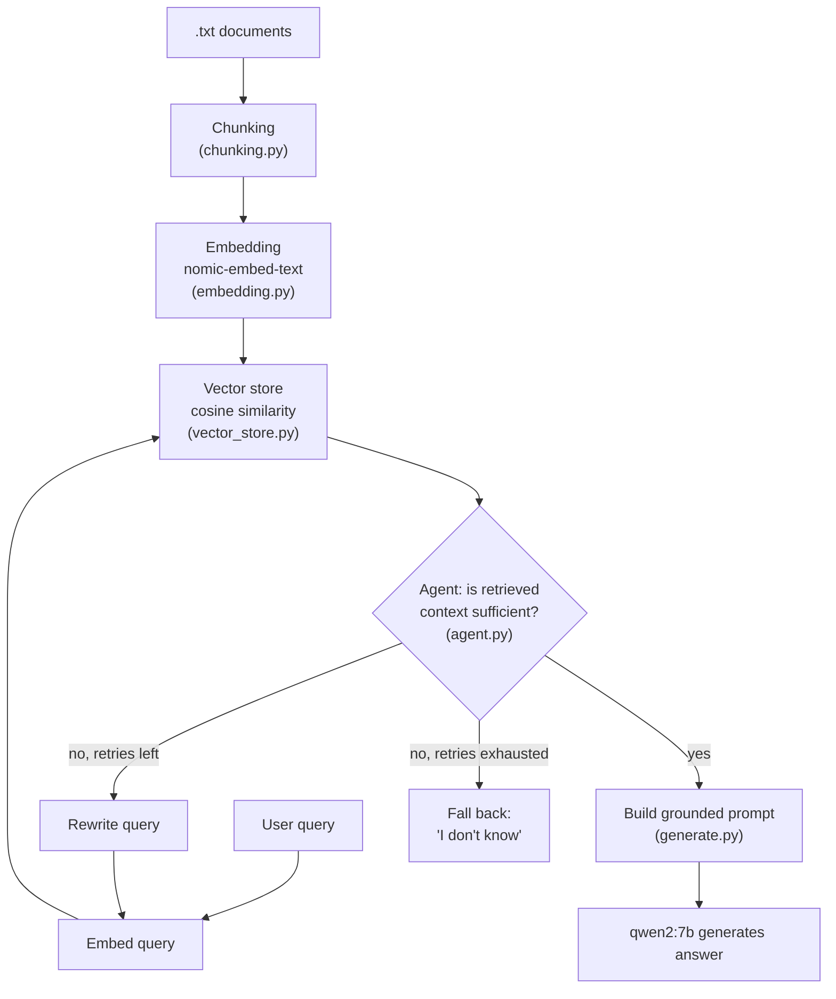

# RAG From Scratch

A retrieval-augmented generation (RAG) pipeline built entirely from first
principles in Python — no LangChain, no LlamaIndex, no managed vector database.
Every stage (chunking, embedding, similarity search, retrieval-quality
judgment, query rewriting) is implemented directly so the mechanics are fully
visible and debuggable, rather than hidden behind framework abstractions.

Runs fully locally via [Ollama](https://ollama.com) — no API keys, no cloud
calls, no per-token cost.

## Why build RAG from scratch

Frameworks like LangChain are convenient in production, but they make it easy
to wire together a RAG pipeline without understanding what each stage is
actually doing to your data — how chunk boundaries affect retrieval, why
cosine similarity is the right metric for normalized embeddings, or what a
"low-confidence retrieval" looks like in practice. This project exists to
make every one of those decisions explicit and inspectable, and to measure
their effect with real numbers rather than assuming a framework default is
good enough.

## Architecture



## How it works

1. **Chunking** (`chunking.py`) — two strategies are implemented and kept
   side by side: `chunk_text_naive()` (the original period-based regex
   split) and `chunk_text_improved()` (fixed ~200-token chunks with 40-token
   overlap, used by default). The improved version exists specifically
   because the naive one produced ~16,700 chunks averaging ~54 characters
   each on this project's real documents — far too short to carry useful
   context.
2. **Embedding** (`embedding.py`) — converts each chunk into a 768-dimension
   vector via Ollama's `nomic-embed-text` model.
3. **Vector store** (`vector_store.py`) — cosine similarity search over
   chunks, implemented from scratch with NumPy (no FAISS, no managed DB).
4. **Generation** (`generate.py`) — builds a prompt that grounds the model's
   answer strictly in retrieved context, and calls `qwen2:7b`.
5. **Agent loop** (`agent.py`) — after retrieval, a second LLM call judges
   whether the retrieved context actually contains an answer to the question.
   If not, it rewrites the query and retries retrieval (up to a configurable
   limit) before falling back to an explicit "I don't know" rather than
   hallucinating from insufficient context.
6. **Entry point** (`main.py`) — wires the above into an interactive terminal
   chat loop with conversation memory.

## Knowledge base

Four public-domain U.S. government mining-safety publications (NIOSH / Bureau
of Mines), covering haulage, maintenance, blasting, and underground mobile
equipment:

- [Haulage Truck Dump Site Safety](https://www.cdc.gov/niosh/media/pdfs/2026/04/2001-124.pdf) (NIOSH 2001-124)
- [IC 9424: Mobile Mine Equipment Maintenance Safety](https://stacks.cdc.gov/view/cdc/206404/cdc_206404_DS1.pdf) (Bureau of Mines, 1995)
- [IC 8925: Explosives and Blasting Procedures Manual](https://stacks.cdc.gov/view/cdc/206002/cdc_206002_DS1.pdf) (Bureau of Mines, 1983)
- [Injuries associated with continuous miners, shuttle cars, and LHDs](https://stacks.cdc.gov/view/cdc/8904/cdc_8904_DS1.pdf) (NIOSH)

## Quickstart

```bash
# 1. Install Ollama: https://ollama.com/download

# 2. Pull the required models
ollama pull qwen2:7b
ollama pull nomic-embed-text

# 3. Set up the environment
python3 -m venv .venv
source .venv/bin/activate
pip install -r requirements.txt

# 4. (Optional) Verify Ollama is reachable
python3 scripts/check_ollama_connection.py

# 5. Run it
python3 main.py

```

## Example session

```
Loading knowledge base...
No valid cache found — embedding all documents from scratch...
Cached 1024 chunks to disk for next time.
Ready — 1024 chunks loaded.

Ask a question (or 'quit'): What are the main causes of injuries at haulagetruck dump sites?
  [attempt 1] query: 'What are the main causes of injuries at haulage truckdump sites?' -> sufficient: False
  [attempt 2] query: 'What factors contribute to serious injuries involvinghaulage trucks at dump sites during the period from 1988 to 1997, as reported by the Mine Safety and Health Administration (MSHA)?' -> sufficient: True

The main causes of injuries at haulage truck dump sites are related to the operations and activities involving trucks at these sites. Specifically, thecontext highlights that these injuries are characterized by a high likelihood of resulting in death or significant amounts of lost time compared to most other surface mine injuries. This indicates that the nature of truck operations at dump sites poses a significant safety concern.


Ask a question (or 'quit'): What is the average purchase price of a new mining haul truck?
  [attempt 1] query: 'What is the average purchase price of a new mining haul truck?' -> sufficient: False
  [attempt 2] query: 'What is the average purchase price for a new off-highway ore haulage truck in the context of mining operations?' -> sufficient: False

I don't know.

```

(Real transcript — not fabricated. The second example exists specifically to show the retry-then-fallback path, not just the happy path.)

## Design decisions

- **Cosine similarity over Euclidean distance** — `nomic-embed-text` produces
  embeddings where *direction* carries semantic meaning more reliably than
  magnitude, so cosine similarity (which ignores magnitude) is the correct
  metric here, not an arbitrary choice.
- **A second LLM call to judge retrieval quality** — most minimal RAG
  implementations assume the top-k retrieved chunks are always good enough to
  answer from. This project doesn't assume that: a judge call explicitly
  checks sufficiency before generation, and a failed check triggers a
  rewritten query rather than silently answering from weak context.
- **Explicit fallback over hallucination** — when retries are exhausted, the
  system says "I don't know" rather than generating an answer from
  insufficient context. This is a deliberate trade-off: fewer confident-but-
  wrong answers, at the cost of sometimes refusing a question a better
  retrieval system could have answered.
- **Token-based chunking with overlap over sentence-splitting** — naive
  period-splitting on real documents produced mostly tiny, low-context
  fragments (numbered lists and table noise masquerading as "sentences").
  Switching to fixed ~200-token chunks with 40-token overlap visibly
  changed real answers on the same test questions: one question that
  previously got "I don't know" under naive chunking returned a concrete,
  5-point grounded answer under improved chunking, on the first retrieval
  attempt instead of needing a retry. A formal, quantified comparison
  across a full evaluation set is still pending (see Roadmap).

## Known limitations (honest, not hidden)

- The naive chunking function still exists (`chunk_text_naive()`) and
  produces very short, low-context fragments on real documents — it's kept
  only for comparison against the improved chunker, not used by default.
- Chunk size (200 tokens) and overlap (40 tokens) were chosen as reasonable
  starting values, not tuned against a formal evaluation yet.
- The agent's rewrite-and-retry loop can only rephrase a query — it cannot
  retrieve facts that were never in the knowledge base to begin with.
- `max_attempts` (the retry limit) is hardcoded to 2 in `main.py` rather than
  configurable.
- PDF-to-text extraction of charts and figures in the source documents
  sometimes produces garbled, non-sentence text fragments. These were
  manually reviewed and removed where found, but perfect extraction wasn't
  the goal of this project — some residual noise may remain in
  less-reviewed sections of the longer documents.
- No automated tests, no CI, and no quantitative evaluation of retrieval
  quality yet (in progress — see Roadmap).

## Roadmap

- [x] Domain-relevant public knowledge base (mining / heavy-equipment
      documentation)
- [x] Persist embeddings and chunks to disk instead of recomputing every run
- [x] Token-aware chunking with overlap, implemented alongside the original
      naive chunker for comparison
- [ ] Formal 25–30 question evaluation set with known source chunks,
      measuring hit rate / recall@k and MRR, naive vs. improved chunking,
      and how often the rewrite-and-retry loop actually changes the outcome
- [ ] pytest unit tests (chunking, cosine similarity, vector store) with
      Ollama calls mocked
- [ ] GitHub Actions CI (lint + tests on every push)
- [ ] Config file replacing hardcoded values; type hints; packaging cleanup
- [ ] Terminal demo GIF

## Requirements

- Python 3.9+
- [Ollama](https://ollama.com), with `qwen2:7b` and `nomic-embed-text` pulled
- Tested on macOS (MacBook Air)