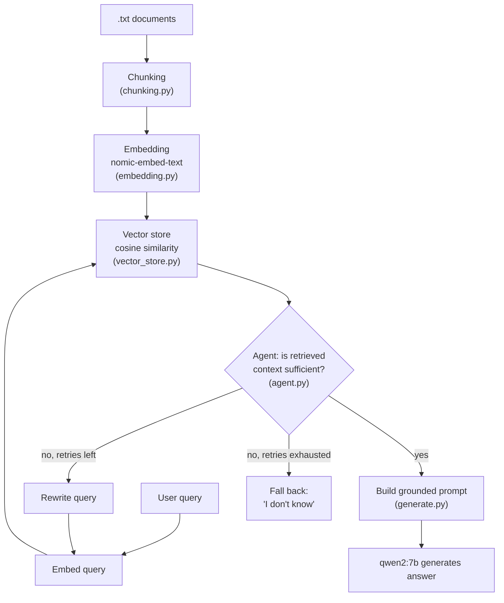

# RAG From Scratch

A retrieval-augmented generation (RAG) pipeline built entirely from first
principles in Python — no LangChain, no LlamaIndex, no managed vector database.
Every stage (chunking, embedding, similarity search, retrieval-quality
judgment, query rewriting) is implemented directly so the mechanics are fully
visible and debuggable, rather than hidden behind framework abstractions.

Runs fully locally via [Ollama](https://ollama.com) — no API keys, no cloud
calls, no per-token cost.

## Why build RAG from scratch

Frameworks like LangChain are convenient in production, but they make it easy
to wire together a RAG pipeline without understanding what each stage is
actually doing to your data — how chunk boundaries affect retrieval, why
cosine similarity is the right metric for normalized embeddings, or what a
"low-confidence retrieval" looks like in practice. This project exists to
make every one of those decisions explicit and inspectable, and to measure
their effect with real numbers rather than assuming a framework default is
good enough.

## Architecture



## How it works

1. **Chunking** (`chunking.py`) — splits `.txt` documents into sentence-level
   chunks using a regex that splits on periods followed by whitespace, so
   most abbreviation-period false splits are avoided.
2. **Embedding** (`embedding.py`) — converts each chunk into a 768-dimension
   vector via Ollama's `nomic-embed-text` model.
3. **Vector store** (`vector_store.py`) — cosine similarity search over
   chunks, implemented from scratch with NumPy (no FAISS, no managed DB).
4. **Generation** (`generate.py`) — builds a prompt that grounds the model's
   answer strictly in retrieved context, and calls `qwen2:7b`.
5. **Agent loop** (`agent.py`) — after retrieval, a second LLM call judges
   whether the retrieved context actually contains an answer to the question.
   If not, it rewrites the query and retries retrieval (up to a configurable
   limit) before falling back to an explicit "I don't know" rather than
   hallucinating from insufficient context.
6. **Entry point** (`main.py`) — wires the above into an interactive terminal
   chat loop with conversation memory.

## Quickstart

```bash
# 1. Install Ollama: https://ollama.com/download

# 2. Pull the required models
ollama pull qwen2:7b
ollama pull nomic-embed-text

# 3. Set up the environment
python3 -m venv .venv
source .venv/bin/activate
pip install -r requirements.txt

# 4. (Optional) Verify Ollama is reachable
python3 scripts/check_ollama_connection.py

# 5. Run it
python3 main.py
```


## Example session

```
Loading knowledge base...
Ready — 13 chunks loaded.

Ask a question (or 'quit'): How often should I change the oil on a Caterpillar excavator?
  [attempt 1] query: 'How often should I change the oil on a Caterpillar excavator?' -> sufficient: True

Every 500 operating hours.

Ask a question (or 'quit'): What's the warranty period on an Atlas Copco drill rig?
  [attempt 1] query: 'What's the warranty period on an Atlas Copco drill rig?' -> sufficient: False
  [attempt 2] query: 'What is the warranty duration for an Atlas Copco drill rig?' -> sufficient: False

I don't know. The context provided doesn't include information about the warranty period on an Atlas Copco drill rig.
```

(Real transcript — not fabricated. The second example exists specifically to
show the retry-then-fallback path, not just the happy path.)
